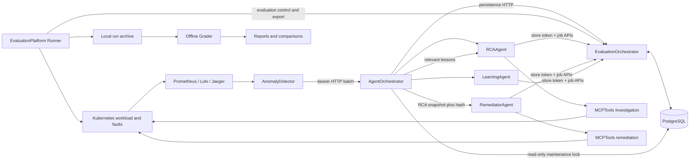

# Architecture

AgentOrchestrator (`Agents/Orchestrator`) owns workflow decisions and dispatch.
EvaluationOrchestrator (`EvaluationPlatform/Orchestrator`) owns all application
DML, job-store APIs, evaluation control, and session exports.
RCAAgent owns analysis and sub-agent orchestration. RemediatorAgent owns
approved execution and verification. All three job services persist through
EvaluationOrchestrator HTTP APIs and do not hold PostgreSQL credentials. LearningAgent
turns completed workflow evidence into atomic lessons and also persists only
through EvaluationOrchestrator. MCPTools owns
all cluster-facing capabilities and is deployed twice: a read profile with
read-oriented RBAC, and a remediation profile with a separate token, bounded
RBAC, one replica, and a PVC.

The singleton `agent_execution_slot` serializes RCA, remediation, and learning jobs,
including direct API submissions. Automated `awaiting_approval` does not hold
the lease; remediator claims it after RCA releases.
The bundled agent-platform HTTP Services are ClusterIP-only. NetworkPolicy, bearer authentication,
server-side tool profiles, and Kubernetes RBAC are independent security layers.

Application namespace is a first-class incident field. The detector preserves
it from Prometheus labels, AgentOrchestrator isolates namespaced batches and
lesson retrieval, RCA profiles the incident namespace rather than assuming an
application topology, and remediation authority is granted per namespace with
a RoleBinding. Cluster-scoped node incidents remain explicit and may require
profiling every configured application namespace.

Deployment ownership follows runtime ownership: every component keeps its
ConfigMap, placeholder Secret, manifests, and a deploy script that uses
kubectl's current context. AgentOrchestrator owns the shared ingress
NetworkPolicy. DatabaseJob owns PostgreSQL and migration resources.
Infrastructure installs platform tools and namespaces only.

The Grader reads local Runner archives and uses the configured model judge for
semantic grading. Archive measurements and report generation run locally;
`--operational-only` disables model calls. Grading does not contact the live
cluster or change archived evidence. See the [Grader guide](../EvaluationPlatform/Grader/README.md).

Evaluation reset/export also travels through EvaluationOrchestrator HTTP APIs. The durable
`evaluation_control` singleton gates dispatch during maintenance and owns one
serial run. Database DDL is isolated under EvaluationPlatform/Database. Lifecycle
integrations and ordered pre/post shell hooks keep the Runner solution-agnostic.

The two orchestrators are independent FastAPI services. EvaluationOrchestrator
has no agent clients or scheduler. AgentOrchestrator calls authenticated internal
persistence endpoints and keeps a read-only PostgreSQL transaction open around
dispatch, using the existing advisory lock and `evaluation_control` row. This
preserves pause/reset synchronization across the service boundary; only
EvaluationOrchestrator writes rows. Both remain running during baseline.

This split changes service ownership and endpoint hosts, not the database schema,
RCA/remediation payloads, six session exports, or Runner archive format. Existing
archives remain readable by Grader and do not require experiments to be rerun.
Runner continues to create the full archive locally and optionally upload it to
S3; no new archive or summary submission format is introduced.
